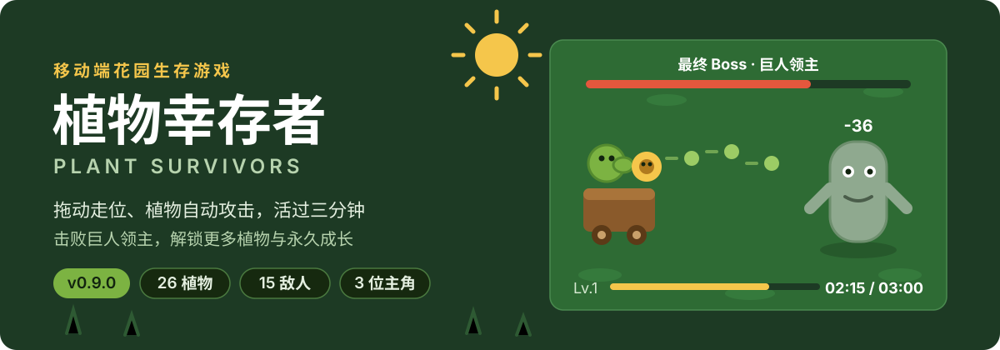
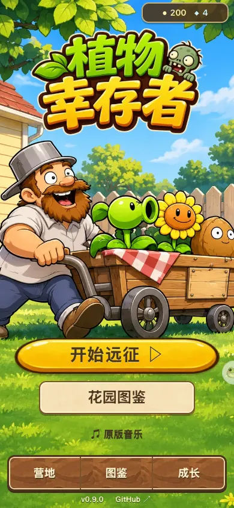
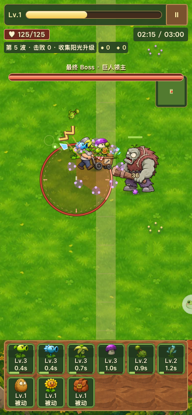

<p align="right"><a href="README.md">中文</a></p>

<p align="center">
  
</p>

<p align="center">
  <a href="https://xiaosang.cc/plant-survivors-ui/">▶ Play Online</a>
  ·
  <a href="https://github.com/holynova/plant-survivors-ui">GitHub Repository</a>
</p>

Plant Survivors is a mobile-first survival game: drag anywhere to move, your plants attack automatically. Three heroes roam three large scrolling worlds with a following camera. 26 plants, 18 enemy types, upgrades, evolutions, and a field guide — endless survival with four bosses rotating in; defeating a boss is a milestone, and dying after a boss kill unlocks the next map.

**v0.15.1** Rescaled terrain, scenery and actors across all three maps. Updated the loading art, character portraits, map cards and reward icons. [See in-game comparisons](https://xiaosang.cc/plant-survivors-ui/qa/scale-art).

**v0.15.0** adds ground collisions, rare healing drops, clearer upgrade and hit feedback, and repacked combat effects. [Mobile battle captures](https://xiaosang.cc/plant-survivors-ui/qa/combat).

**v0.14.1** paints loading, camp and battle scenery to the screen edges while keeping controls inside the safe area. [Viewport checks](https://xiaosang.cc/plant-survivors-ui/qa/full-bleed).

**v0.14.0** updates camp navigation, hero portraits, upgrade choices and character scale. [Mobile QA: 252 runtime screenshots across 12 viewports](https://xiaosang.cc/plant-survivors-ui/qa/camp).

## Screenshots

<p align="center">
  
  
</p>

## How to Play

- **Move**: drag anywhere on the screen, either hand works; keyboard controls are also supported.
- **Auto-attack**: plants fire on their own rhythm — you just dodge, avoid skills, and pick up sun to level up.
- **Pick 1 of 3 on level-up**: choose one of three upgrades each time you level; re-rolls are available (limited per run).
- **Evolve**: a main plant at Lv.5 with the right companion evolves. Three evolution paths — 豌豆射手 Peashooter → 烈焰机枪 Gatling Blaze, 寒冰射手 Ice Pea → 霜晶风暴 Frost Storm, 回旋镖 Boomerang → 追风回旋阵 Windchaser Array.
- **Three heroes**: 戴夫 Dave (sturdy apron, high HP and damage reduction), 小葵 Flora (sun affinity, +25% XP), 阿栓 Rusty (overclocked backpack, faster attack and movement speed).
- **Three maps**: 白天花园 Day Garden, 夜晚花园 Night Garden, 屋顶 Rooftop — each with its own terrain mechanics and rescue objectives.
- **Enemies**: 12 regular zombies (普通 zombie, 路障 cone, 铁桶 bucket, 读报 newspaper, 橄榄球 football, 矿工 digger, 舞王 dancer, 巫师 wizard, 小鬼 imp, 气球 balloon, 喷气 jetpack, 纱门 screen-door) + 2 elites (疾走队长 Swift Captain, 铁桶统领 Bucket Commander) + 4 bosses (巨人领主 Giant Lord, 橄榄球队长 Football Captain, 沼泽大法师 Marsh Archmage, 屋顶机甲 Rooftop Mech) that rotate in — the first appears at 2:15, then one every 2 minutes.
- **Endless runs & milestones**: no run timer; defeating a boss is a milestone, and dying after a boss kill unlocks the next map.
- **Out-of-run growth**: elites and the boss drop coins and diamonds for unlocking new plants and permanent upgrades; local saves, resumable runs.

## Content

- **26 plants**: 豌豆 Pea, 寒冰 Ice Pea, 回旋镖 Boomerang, 大喷菇 Fume-shroom, 卷心菜 Cabbage, 玉米 Corn, 西瓜 Melon, 樱桃 Cherry, 火爆辣椒 Jalapeño, 土豆地雷 Potato Mine, 大嘴花 Chomper, 窝瓜 Squash, 杨桃 Starfruit, 仙人掌 Cactus, 菜问 Bonk Choy, 火龙草 Snapdragon, 闪电芦苇 Lightning Reed, 激光豆 Laser Bean, 竹笋炮手 Bamboo Shooter, 椰子加农炮 Coconut Cannon, 冰冻生菜 Iceberg Lettuce, 电能卷心菜 Electric Cabbage, plus 向日葵 Sunflower, 坚果 Wall-nut, 火炬树桩 Torchwood, 磁力菇 Magnet-shroom and other passives and gear. Carry up to 6 active + 3 passive plants at once.
- **Field guide**: the garden guide documents every plant and enemy, with mechanics explained.
- **Music**: the original soundtrack plays through the composer's official player (needs network + a play click); four offline synthesized tracks with pause/resume and independent volumes. Battle sound effects, pause, and local saves included.

## Run Locally

```bash
npm ci
npm run dev        # Vite dev server
npm run build      # Production build
```

## Tests

```bash
npm run test:game  # Game-logic tests: 12 test files + campaign simulation
npm run test:sites
npm run test:mobile
npm run test:performance
```

## Tech

- React 19 + TypeScript + Vite; Canvas rendering, with a deterministic simulation core (`src/game/simulation.ts`) testable without the UI.
- Mobile-first: native safe areas, landscape layout, touch gestures, asset preload progress bar.

```
src/Prototype.tsx     Main screen and game flow
src/game/simulation.ts  Combat simulation core (movement / shooting / upgrades / evolutions / Boss)
src/game/plants.ts    26 plant definitions
src/game/enemies.ts   12 enemy definitions
src/game/catalog.ts   Heroes, elites, boss
src/game/renderer.ts  Canvas rendering
src/game/audio.ts     Sound effects and music
src/mobile/           Mobile components (carousel, bottom drawer, keyboard, etc.)
tests/                Game-logic / mobile / performance tests
```
