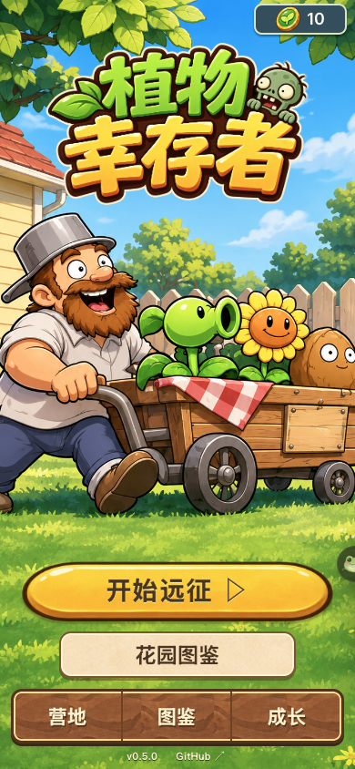

# 植物幸存者 · Plant Survivors

[Demo](https://xiaosang.cc/plant-survivors-ui/) · [Repo](https://github.com/holynova/plant-survivors-ui)

发布状态：v0.5.0 已构建并通过验收，线上仍为 v0.4.0。共享 Worker 发布缺少图库完整构建，恢复该依赖后再更新线上。 / v0.5.0 verified locally; live deployment is pending the shared gallery build.

经典后院风格的手机端单机幸存者游戏，直接铺满浏览器，不使用模拟手机外壳。适配横竖屏、动态可视高度与安全区。三位主角、三张地图、升级进化与图鉴；移动躲避、植物自动攻击。v0.5.0 放大精英，加入冲锋与重甲弱点，放慢成长节奏并提高后期压力。支持摇杆、键盘、音效、暂停和本地存档。种子用于记录奖励，暂无商店。

A full-viewport mobile survival game with native touch scrolling, safe-area support and portrait/landscape layouts. Three heroes, three maps, plant evolution and a field guide. Larger elites use telegraphed charges and armor windows; progression is slower with stronger late-game pressure. Joystick and keyboard controls, audio, pause and local saves are included. No simulated phone frame, accounts or cloud sync.



## 运行 / Run

```sh
npm ci
npm run dev
```

## 测试与构建 / Test and build

```sh
npm run test:game
npm run test:sites
npm run build:release
```

Production assets in `dist/client` target `/plant-survivors-ui/`. Copy this build into the portfolio repository's matching folder, commit to its master branch, then stage that committed tree and manually deploy the existing `xiaosang-portfolio` Worker. Do not create another Worker.

[v0.5 难度与手机尺寸验收 / Balance and viewport checks](docs/V05-VERIFICATION.md) · [分阶段测试报告 / Test report](docs/TEST-REPORT.md) · [素材说明 / Assets](ASSETS.md)


