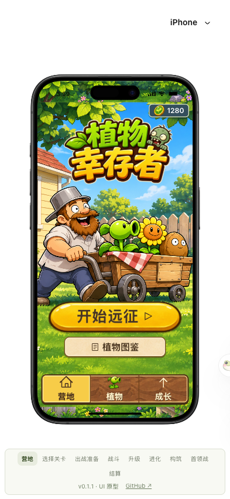

# 植物幸存者 · Plant Survivors

[Demo](https://plant-survivors-ui.xiaosang.cc/) · [Repo](https://github.com/holynova/plant-survivors-ui)

经典后院风格的移动端可点击 UI 原型，包含营地、关卡、出战准备、战斗、升级、进化、构筑、首领战与结算九个场景。战斗和数值为演示，尚不是完整游戏。

A mobile-first clickable UI prototype with nine garden-themed scenes: camp, stages, preparation, battle, upgrades, evolution, builds, boss battle and results. Combat and numbers are demonstrative; this is not a complete game.



## 运行 / Run

```sh
npm ci
npm run dev
```

## 检查与发布 / Check and deploy

```sh
npm run test:sites
npm run build
npm run deploy:check
npm run deploy
```

Cloudflare Workers serves the production build on the custom domain above. Deploy manually from the committed main branch with an authenticated Wrangler account.

## 手机访问 / Open on mobile


[原型说明 / Prototype notes](docs/PROTOTYPE.md) · [素材说明 / Asset notes](ASSETS.md)
