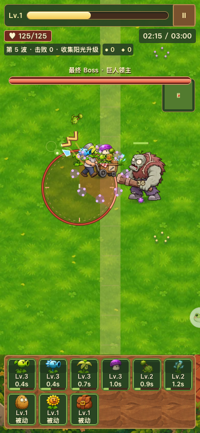

<p align="center">
  
</p>

<p align="center">
  <a href="https://xiaosang.cc/plant-survivors-ui/">▶ 在线玩 Play Online</a>
  ·
  <a href="https://github.com/holynova/plant-survivors-ui">GitHub 仓库</a>
</p>

植物幸存者是一款手机优先的单机幸存者游戏：任意位置触摸拖动走位，植物自动攻击；三位主角在三张大地图上自由行走，镜头持续跟随。26 种植物、15 类敌人，升级、进化、图鉴一应俱全；每局 3 分钟，击败最终 Boss 巨人领主才算胜利。

Plant Survivors is a mobile-first survival game: drag anywhere to move, your plants attack automatically. Three heroes roam three large scrolling worlds with a following camera. 26 plants, 15 enemy types, upgrades, evolutions, and a field guide — each run lasts 3 minutes, and you only win by defeating the final boss, the Giant Lord.

## 截图 / Screenshots

<p align="center">
  
  
</p>

## 玩法 / How to Play

- **走位**：任意位置触摸拖动，左右手皆可；也支持键盘操作。
- **自动攻击**：植物按各自节奏自动开火，你只管走位、躲技能、拾阳光升级。
- **升级三选一**：升级时从三个选项里挑一个强化；可重洗（每局次数有限）。
- **进化**：主植物 Lv.5 + 指定搭配即可进化，三条进化路线——豌豆射手 → 烈焰机枪、寒冰射手 → 霜晶风暴、回旋镖 → 追风回旋阵。
- **三位主角**：戴夫（厚实围裙，高生命减伤）、小葵（阳光亲和，经验 +25%）、阿栓（超频背包，攻速移速更快）。
- **三张地图**：白天花园、夜晚花园、屋顶，各有地形机制与救援目标。
- **敌人**：12 种普通僵尸（路障、铁桶、读报、橄榄球、矿工、舞王、巫师、小鬼、气球、喷气、纱门等）+ 2 精英（疾走队长、铁桶统领）+ 首领巨人领主（剩余 45 秒登场，半血狂暴并召唤僵尸）。
- **局外成长**：精英和首领掉落金币、钻石，用于局外解锁新植物与永久成长；本地存档，战局可恢复。

## 内容 / Content

- **26 种植物**：豌豆、寒冰、回旋镖、大喷菇、卷心菜、玉米、西瓜、樱桃、火爆辣椒、土豆地雷、大嘴花、窝瓜、杨桃、仙人掌、菜问、火龙草、闪电芦苇、激光豆、竹笋炮手、椰子加农炮、冰冻生菜、电能卷心菜，另有向日葵、坚果、火炬树桩、磁力菇等被动与装备。最多同时携带 6 主动 + 3 被动。
- **图鉴**：花园图鉴收录全部植物与敌人，含机制说明。
- **音乐**：原版音乐通过作者官方播放器播放（需联网并点击播放）；另有四段离线原创合成配乐，支持暂停续播与独立音量。战斗音效、暂停、本地存档齐全。

## 本地运行 / Run Locally

```bash
npm ci
npm run dev        # Vite 开发服务器
npm run build      # 生产构建
```

## 测试 / Tests

```bash
npm run test:game  # 70 项游戏逻辑测试，全部通过
npm run test:sites
npm run test:mobile
npm run test:performance
```

## 技术 / Tech

- React 19 + TypeScript + Vite；Canvas 渲染，确定性模拟核心（`src/game/simulation.ts`）可脱离界面独立测试。
- 移动端优先：原生安全区、横屏布局、触摸手势、资源预加载进度条。

```
src/Prototype.tsx     主界面与流程
src/game/simulation.ts  战斗模拟核心（移动 / 射击 / 升级 / 进化 / Boss）
src/game/plants.ts    26 种植物定义
src/game/enemies.ts   12 种敌人定义
src/game/catalog.ts   主角、精英、首领
src/game/renderer.ts  Canvas 渲染
src/game/audio.ts     音效与音乐
src/mobile/           移动端组件（轮播、底部抽屉、键盘等）
tests/                游戏逻辑 / 移动端 / 性能测试
```

## English

**Plant Survivors** is a mobile-first survivor game: drag anywhere to move while your plants auto-attack. Three heroes (Dave, Flora, Rusty), three large scrolling maps (day garden, night garden, rooftop), 26 plants, and 15 enemy types.

- **Runs last 3 minutes**: level up, pick 1 of 3 upgrades, evolve your main plant at Lv.5 (three evolution paths: Peashooter → Gatling Blaze, Ice Pea → Frost Storm, Boomerang → Windchaser Array). The Giant Lord appears with 45 seconds left — you only win by defeating it.
- **Enemies**: 12 regular zombies (cone, bucket, newspaper, football, digger, dancer, wizard, imp, balloon, jetpack, screen-door…), 2 elites, and 1 boss. Elites and the boss drop coins and diamonds for out-of-run unlocks and permanent growth.
- **Loadout**: up to 6 active + 3 passive plants; a field guide documents every plant and enemy.
- **Music**: original PvZ music via the composer's official online player (needs network + a play click); four offline synthesized tracks with pause/resume and independent volumes. Local saves, resumable runs, keyboard controls, sound effects.
- **Run it**: `npm ci && npm run dev`. Tests: `npm run test:game` (70 passing).
- **Tech**: React 19 + TypeScript + Vite, Canvas rendering, deterministic simulation core testable without the UI.
