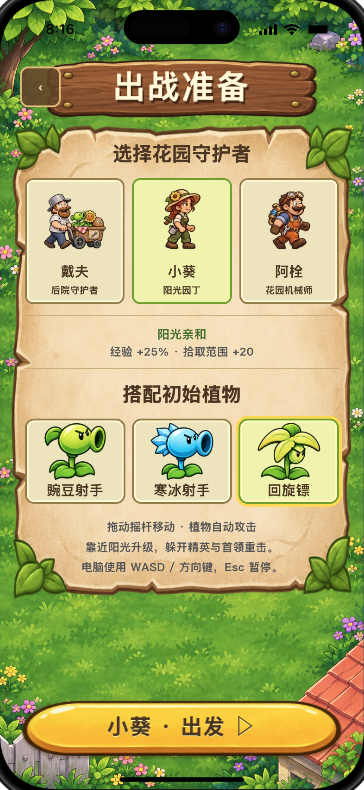

# 植物幸存者 · Plant Survivors

[Demo](https://xiaosang.cc/plant-survivors-ui/) · [Repo](https://github.com/holynova/plant-survivors-ui)

经典后院风格的移动端单机幸存者游戏。拖动摇杆移动，植物自动攻击；收集阳光，三选一升级，组合植物与被动触发进化，击败首领解锁地图。共三关，每关约 3–4 分钟，支持键盘、暂停、结算和本地存档。v0.4.0 提供三位特性不同的主角、精英波次、半血狂暴首领、植物冷却显示及完整图鉴；角色独立步态、回旋返航、冰晶与孢子弹道均已实装。种子用于记录奖励，暂无商店。

A mobile-first survival game: move with the joystick or WASD/arrows, auto-attack enemies, collect sunlight, choose upgrades, evolve plants and defeat bosses. Three stages last roughly 3–4 minutes each. Three distinct heroes, scheduled elites, an enraging final boss, cooldown HUD and a full field guide are included. Grounded walk cycles, returning boomerangs, ice shards and spreading spores have distinct effects and audio. Progress is saved locally. Seeds record rewards; there is no shop or cloud sync.



## 运行 / Run

```sh
npm ci
npm run dev
```

## 测试与构建 / Test and build

```sh
npm run test:game
npm run test:sites
npm run build:release
```

Production assets in `dist/client` target `/plant-survivors-ui/`. Copy this build into the portfolio repository's matching folder, commit to its master branch, then stage that committed tree and manually deploy the existing `xiaosang-portfolio` Worker. Do not create another Worker.

[实机战斗录屏 / Recorded test battle](assets/gameplay-v04.mp4) · [分阶段测试报告 / Test report](docs/TEST-REPORT.md) · [素材说明 / Assets](ASSETS.md)


